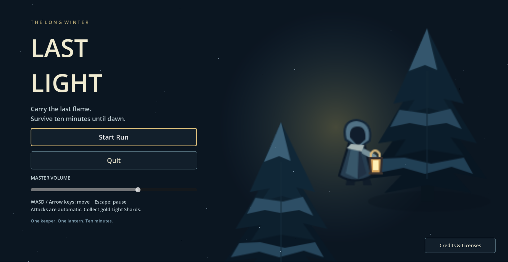
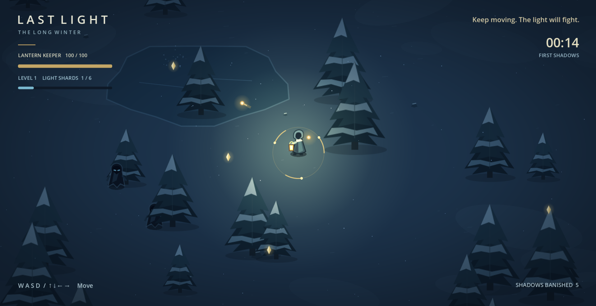

# 🕯️ LAST LIGHT — *The Long Winter*

> *"Carry the last flame. Survive ten minutes until dawn."*


**Last Light** adalah game *2D Top-Down Survival Roguelite / Bullet Heaven* bertema musim dingin yang gelap dan atmosferik, dibangun menggunakan **Godot Engine 4.7**. Kamu berperan sebagai **Lantern Keeper** terakhir yang membawa lentera supranatural di tengah dunia yang membeku (*The Long Winter*). Makhluk-makhluk bayangan terus berdatangan dari kegelapan—tugasmu adalah bertahan hidup selama **10 menit** hingga fajar kembali menyingsing.

---

## 📸 Screenshots

### Start Screen (Main Menu)


### Gameplay


---

## ✨ Fitur Utama

- **Movement-Centric Bullet Heaven**: Fokus sepenuhnya pada penempatan posisi (*positioning*), menghindar dari kepungan bayangan, dan mengumpulkan *Light Shards*—semua serangan senjata berjalan secara otomatis.
- **Atmosfer Musim Dingin yang Kuat**: Arena bersalju berukuran `4400 × 3200` dengan lingkaran batu kuno, danau beku, pepohonan pinus, *world-space snow particles*, *winter vignette shader*, serta pencahayaan lentera dinamis yang hangat.
- **3 Senjata Otomatis Aktif Sejak Awal**:
  | Senjata | Mekanik Dasar |
  | :--- | :--- |
  | **Light Orb** | Membidik musuh terdekat secara otomatis dalam jarak 650 px dan menembakkan proyektil cahaya setiap 0.8 detik. |
  | **Halo** | Cincin emas berputar di sekitar karakter (radius 60 px) yang memberikan *area damage* setiap 0.65 detik. |
  | **Frost Pulse** | Gelombang es melingkar (radius 150 px) setiap 4 detik yang melukai musuh dan memperlambat gerak mereka sebesar 50% selama 1.5 detik. |
- **Sistem Level-Up & 10 Pilihan Upgrade**:
  Musuh yang dikalahkan menjatuhkan **Light Shards** (XP). Saat naik level, permainan berhenti sejenak dan menawarkan 3 kartu upgrade acak:
  - **Pale Flame** — +20% *Light Orb* damage *(Repeatable)*
  - **Quickening** — +15% kecepatan serangan untuk semua senjata *(Repeatable)*
  - **Moon's Reach** — +15% radius penarik *Light Shards* *(Repeatable)*
  - **Winter Stride** — +20% kecepatan gerak karakter *(Max Rank 5)*
  - **Steadfast** — +20 Max HP & memulihkan 20 HP *(Max Rank 5)*
  - **Twin Flame** — +1 proyektil tambahan per tembakan *Light Orb* *(Max Rank 3)*
  - **Searing Halo** — +20% *Halo* damage *(Max Rank 5)*
  - **Winter Crown** — +20% radius *Halo* *(Max Rank 5)*
  - **Deep Freeze** — +20% *Frost Pulse* damage *(Max Rank 5)*
  - **Frozen Horizon** — +20% radius *Frost Pulse* *(Max Rank 5)*
- **Varian Musuh & Eskalasi Kesulitan Dinamis**:
  Tekanan musuh meningkat secara bertahap dari menit `00:00` hingga `10:00` (interval spawn makin cepat hingga 0.32 detik, batas populasi hingga 150 musuh, serta pengganda HP, kecepatan, dan damage):
  - **Wraith** — Bayangan dasar dengan kecepatan dan HP seimbang.
  - **Crawler** — Bayangan gesit yang mengejar dengan kecepatan tinggi.
  - **Watcher** — Bayangan besar ber-HP tebal dengan *contact damage* tinggi.
- **Pertarungan Boss — *The Pale One***:
  Muncul pada menit ke-8 (`08:00`) dengan **2.000 HP**, memberikan *telegraph* cincin peringatan sebelum menembakkan 12 proyektil radial secara berkala.
- **Procedural Audio**: Dilengkapi 13 aset suara WAV orisinal (ambience musim dingin 20 detik yang *looping* serta efek suara tembakan, *hit*, *level-up*, *pulse*, kedatangan boss, hingga kemenangan saat fajar) yang dihasilkan melalui `tools/generate_audio.py`.

---

## 🎮 Kontrol Permainan

| Input | Aksi |
| :--- | :--- |
| **W, A, S, D** / **Arrow Keys (↑ ↓ ← →)** | Menggerakkan Lantern Keeper (8 arah) |
| **Klik Kiri Mouse** / **Tombol 1, 2, 3** | Memilih kartu Upgrade saat *Level Up* |
| **Escape (Esc)** | Membuka / menutup menu *Pause* |
| **Mouse** | Navigasi menu utama, layar hasil, dan pengatur *Master Volume* |

---

## 📂 Struktur Proyek

```text
last-light/
├── assets/
│   ├── audio/          # 13 file WAV (ambience & sound effects)
│   ├── shaders/        # Shader winter vignette
│   ├── sprites/        # Aset vektor SVG orisinal (keeper, musuh, boss, pohon, orb, shard)
│   └── themes/         # Tema UI musim dingin (winter_ui.tres)
├── autoload/
│   └── run_state.gd    # Penyimpan ringkasan run terakhir & pengaturan volume antar-scene
├── docs/
│   └── RELEASE.md      # Dokumentasi paket rilis Windows & hasil verifikasi QA
├── licenses/           # Lisensi Godot Engine & komponen pihak ketiga
├── resources/
│   └── upgrades/       # 10 definisi resource upgrade (.tres)
├── scenes/
│   ├── audio/          # Scene AudioController
│   ├── effects/        # Partikel salju, efek hit, kematian, dan cincin Frost Pulse
│   ├── enemies/        # Scene Wraith, Crawler, Watcher, dan Boss (The Pale One)
│   ├── main/           # Main Menu, Game Arena, dan Result Screen
│   ├── pickups/        # Light Shard (XP pickup)
│   ├── player/         # Karakter pemain & kamera
│   ├── ui/             # Upgrade Menu & Pause Menu
│   └── weapons/        # Light Orb, Halo, Frost Pulse, dan proyektil
├── scripts/            # Seluruh skrip GDScript (player, enemies, game managers, weapons, UI)
├── tests/              # Suite automated smoke test, layout test, & endurance simulation
├── tools/              # Skrip Python untuk audio generator, Windows export builder, & QA
├── LastLight-Menu.png      # Screenshot tampilan awal (Main Menu)
├── LastLight-Gameplay.png  # Screenshot gameplay
└── project.godot       # Konfigurasi proyek Godot 4.7
```

---

## 🚀 Cara Menjalankan Proyek

### 1. Menjalankan dari Godot Editor
1. Pastikan kamu menggunakan **Godot Engine 4.7 (Stable)** (Windows / Linux / macOS).
2. Clone repositori ini:
   ```bash
   git clone https://github.com/arifian853/LostLight.git
   cd LostLight
   ```
3. Buka **Godot Project Manager**, klik **Import**, lalu pilih file `project.godot`.
4. Tekan **F5** (atau tombol *Run Project*) untuk memulai permainan dari `scenes/main/main_menu.tscn`.

### 2. Menjalankan Automated Tests (Headless)
Proyek ini dilengkapi *smoke test* dan simulasi *endurance* 10 menit penuh:
```powershell
# Menjalankan smoke test per milestone
godot --headless --path . --script tests/day2_smoke.gd
godot --headless --path . --script tests/day3_smoke.gd
godot --headless --path . --script tests/day4_smoke.gd
godot --headless --path . --script tests/day5_smoke.gd
godot --headless --path . --script tests/day6_smoke.gd

# Menjalankan simulasi full run 10 menit (600 detik)
godot --headless --fixed-fps 60 --path . --script tests/day5_endurance.gd
```

### 3. Membangun Paket Rilis Windows (`LastLight.exe`)
Untuk mem-build file executable Windows x64 mandiri (*self-contained* dengan PCK tertanam):
```powershell
python tools/fetch_windows_template.py
python tools/build_windows.py --godot "C:\path\to\Godot_v4.7.2-stable_win64.exe"
python tools/qa_windows_release.py --exe dist/LastLight-0.1.2-Windows-x64/LastLight.exe
```
Informasi lebih lengkap mengenai proses *build* dan QA tersedia di [`docs/RELEASE.md`](docs/RELEASE.md).

---

## 📜 Lisensi

Dibangun dengan [Godot Engine](https://godotengine.org/). Informasi hak cipta dan lisensi mesin tersedia di direktori [`licenses/`](licenses/) serta melalui tombol **Credits & Licenses** pada menu utama di dalam game.
